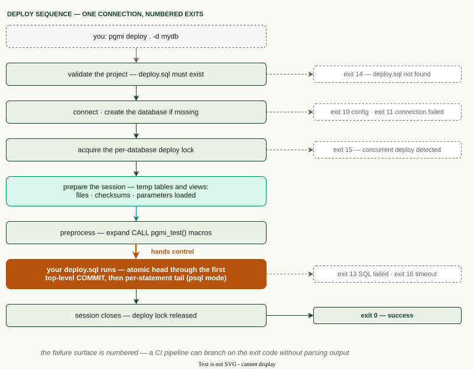

# CI/CD

Deploy pgmi projects from any CI system: install a **pinned** pgmi binary, point
it at a **direct** database connection, and run `pgmi deploy` with a pinned API
version. The connection's credential comes from a CI secret or, with OIDC, from
a short-lived cloud token.

## Requirements

- **A direct PostgreSQL connection** (or a session-mode pooler). Transaction-mode
  poolers — PgBouncer in `transaction` mode, AWS RDS Proxy, Azure's built-in
  PgBouncer — reassign connections between statements and destroy the session-scoped
  temp tables pgmi relies on. See
  [Connection Requirements](PRODUCTION.md#connection-requirements).
- **Secrets from your CI secret store**, never on the command line. See the
  [Security Guide](SECURITY.md).

pgmi's exit codes are the pipeline contract — every failure point is numbered, so CI branches on `$?` instead of parsing output:



## GitHub Actions

```yaml
name: Deploy database

on:
  push:
    branches: [main]

jobs:
  deploy:
    runs-on: ubuntu-latest
    env:
      PGMI_VERSION: v0.14.1         # pin to a specific release tag
      DB_NAME: myapp
    steps:
      - uses: actions/checkout@v5

      - name: Install pgmi (pinned, checksum-verified)
        run: |
          file="pgmi_${PGMI_VERSION#v}_linux_amd64.tar.gz"
          base="https://github.com/vvka-141/pgmi/releases/download/${PGMI_VERSION}"
          curl -fsSLO "${base}/${file}"
          curl -fsSLO "${base}/checksums.txt"
          sha256sum --ignore-missing -c checksums.txt
          tar -xzf "${file}" pgmi
          sudo install pgmi /usr/local/bin/pgmi
          pgmi --version

      - name: Deploy
        env:
          PGMI_CONNECTION_STRING: ${{ secrets.DATABASE_URL }}   # direct connection
        run: pgmi deploy . -d "$DB_NAME" --compat 1 --force --param env=prod
```

Why these choices:

- **Pinned, checksum-verified binary** — no Go toolchain, reproducible runs, and the
  download is integrity-checked against the release `checksums.txt`. Prefer this over
  `go install …@latest`, which recompiles every run and lets a new release silently
  change your deploy.
- **The pinned binary pins the session API.** Before pgmi 1.0 the session API
  may change in a minor release — a view, column or function added, renamed or
  removed — and every change is listed under **Upgrading** in that release's
  notes. Read it before you bump `PGMI_VERSION`.
- **`--compat 1`** makes the deploy fail (exit 10) on a binary that no longer
  ships contract v1, instead of running against a different one. It does not
  freeze columns across pgmi releases before 1.0: v0.14 renamed
  `pgmi_plan_view.checksum` to `pgmi_checksum` within contract 1. See
  [CLI Reference](CLI.md#understanding---compat-api-versioning).
- **`--force`** skips the interactive confirmation (there is no TTY in CI). It does
  **not** drop your database — that is `--overwrite`, which belongs only on
  throwaway/test databases, never production.
- **`PGMI_CONNECTION_STRING`** carries host, user, and password from a single secret.
  Point it at a direct connection, not a transaction-mode pooler.

This is the smallest job. For deploys serialized per database, the deploy
record kept as an artifact, the advanced template's parameters and OIDC, use
the [full job](#github-actions-full-job); for GitLab, the
[GitLab job](#gitlab-ci).

## Pull-request gate without a database

`pgmi metadata validate` and `pgmi metadata plan` read the project and never
connect. Run them on every pull request to catch bad `<pgmi-meta>` blocks,
duplicate ids and an unexpected execution order before anything touches a
database:

```bash
pgmi metadata validate . --json
pgmi metadata plan . --json
```

Both exit 10 on invalid metadata or duplicate ids. See
[CLI Reference](CLI.md#pgmi-metadata-plan) for the JSON shapes.

## Reading the result

`pgmi deploy --json` prints a JSON envelope to stdout on success and on
failure: exit code, SQLSTATE, the failing file and line, plus the pgmi,
contract and PostgreSQL versions, the target host, port and database, and
start and finish times. `connectionSource` names where the connection came
from (the variable holding the connection string, `pgmi.yaml`, `defaults`...), `tls` whether the session was encrypted and under
which `sslmode`, and `overrides` lists every `pgmi.yaml` value an
environment variable or the connection string replaced. A password deploy
belongs on `sslmode=verify-full` with `sslrootcert`: the default `prefer`
falls back to plaintext, which an attacker on the path can force. The same lines go to
stderr, so the CI log shows them too. Branch on the exit code; read the
envelope for the report. See [CLI Reference](CLI.md#--json-envelope).

**Keep the envelope as a build artifact.** A failed deploy rolls back, so an
audit table written by deploy.sql records only successes. The envelope is the
record of the failures. It never contains the connection's user, password or
token, and pgmi redacts a SQL `PASSWORD '...'` literal. Any other secret your
SQL expands inside `EXECUTE` reaches the envelope in a runtime error's
context, so wrap such statements (see [SECURITY.md](SECURITY.md#your-sql-controls-its-own-logging)).

```bash
pgmi deploy . -d "$DB_NAME" --compat 1 --force --param env=prod --json > deploy-result.json
```

**A parameter that was not wired.** The basic and advanced templates refuse a missing or
malformed parameter with exit 13 and `sqlstate` `22023`
(`invalid_parameter_value`), before any change, so CI can tell "the secret was
not passed" from a failed migration. A first deploy refused this way leaves an
empty database behind and is safe to re-run once the parameter is set.

## Concurrent deploys and timeouts

pgmi takes a per-database lock before it runs anything. A second
`pgmi deploy` against the same database does not wait: it exits 15 at once.
Serialize deploys in the CI system, for example with a GitHub Actions
`concurrency:` group per database, so a second run queues instead of failing.
Treat exit 15 as "another deploy is running", not as a broken deploy.
Everything else pgmi guarantees in an unattended run is listed in
[Running unattended](PRODUCTION.md#running-unattended).

`--timeout` (default 3m) covers the whole deploy, including the autocommit tail.
A `CREATE INDEX CONCURRENTLY` that outlives it is cancelled: pgmi exits 16 and
the index is left `INVALID`. Raise `--timeout` for large tables, and write the
build so a re-run reaps the leftover (see
[making a concurrent index re-runnable](DEPLOY-GUIDE.md#making-a-concurrent-index-re-runnable)).

## Environment reference

Everything a pipeline can set for `pgmi deploy`, in one place: what each
variable does, whether it is a secret, and what outranks it.

### Precedence

pgmi first picks one connection string, then resolves each connection field.

| Setting | Highest wins |
|---------|--------------|
| Connection string | `--connection` > `PGMI_CONNECTION_STRING` > `DATABASE_URL`. `-h`, `-p` or `-U` next to either variable exits 10: with `DATABASE_URL` set, adding `-h db.example.com` is refused, never merged and never a silent fall back to localhost. `--sslmode` replaces the string's sslmode, announced on stderr and in `--json` `overrides`. |
| Host, port, user, database, sslmode, TLS paths | flag > the field in the connection string > its `PG*` variable > `pgmi.yaml` > built-in default. With a connection string, `pgmi.yaml` fills only the database ([why](CONFIGURATION.md#precedence-chain)). |
| Parameters | `--param` > `--params-file` (later file wins) > `PGMI_PARAM_*` > `pgmi.yaml` `params` |
| Timeout | `--timeout` > `pgmi.yaml` `timeout` > 3m |
| Project `.env` | A variable already set in the environment wins over the same name in `<project>/.env`. Only `pgmi deploy` reads `.env`; `pgmi serve` ignores it. |

In CI, set variables from the secret store and keep `.env` out of the
checkout. The basic and advanced templates already ignore `*.env` in git.

### Variables

**pgmi's own**

| Variable | Secret | Effect |
|----------|--------|--------|
| `PGMI_CONNECTION_STRING` | yes | Full connection string, URI or `Key=Value;` form |
| `DATABASE_URL` | yes | Connection string when `PGMI_CONNECTION_STRING` is unset |
| `PGMI_PARAM_<NAME>` | when it holds one | Parameter `<name>` (lower-cased), read as `current_setting('pgmi.<name>', true)`. An empty value exits 10, so an unmapped CI secret never arrives as `''` |
| `PGMI_MAX_FILE_SIZE` | no | Per-file cap in bytes (default 10 MiB); any other form exits 10 |
| `CI` (any value), `PGMI_NON_INTERACTIVE=1` | no | Turn off the interactive wizards and prompts. `--overwrite` then needs `--force`, or it exits 12 |
| `PGMI_NO_BANNER`, `NO_COLOR`, `PGMI_PAGER`, `PAGER` | no | Banner, colour and pager (`PGMI_PAGER` before `PAGER`); no effect on the deploy |

**libpq variables pgmi resolves itself.** These take part in the precedence
above, and pgmi names each one that replaces a `pgmi.yaml` value.

| Variable | Secret | Effect |
|----------|--------|--------|
| `PGHOST`, `PGPORT`, `PGUSER`, `PGDATABASE` | no | Host, port, user, target database |
| `PGPASSWORD` | yes | Password; a password in the connection string wins |
| `PGPASSFILE` | no; protect the file | `.pgpass` location (default `~/.pgpass`); a `passfile=` in the connection string wins. As in libpq, a file other users can read is ignored with a warning |
| `PGSSLMODE` | no | TLS mode |
| `PGSSLCERT`, `PGSSLROOTCERT` | no | Client certificate and CA paths |
| `PGSSLKEY` | no; protect the key file | Client private key path |
| `PGSSLPASSWORD` | yes | Passphrase of an encrypted client key |
| `PGAPPNAME` | no | `application_name` (default `pgmi`) |
| `PGCONNECT_TIMEOUT` | no | Connect timeout in seconds |

**Read by the driver.** pgx applies these to every connection pgmi opens. pgmi
does not resolve or report them, except `PGOPTIONS`, which it names on stderr
because it changes every session's settings.

None of them is a secret, and a setting in the connection string outranks
each one.

| Variable | Effect |
|----------|--------|
| `PGOPTIONS` | Server options, e.g. `-c lock_timeout=5s`; stderr prints `session options: from PGOPTIONS` |
| `PGTZ` | Session `TimeZone` |
| `PGTARGETSESSIONATTRS` | `target_session_attrs`, e.g. `read-write` with several hosts |
| `PGREQUIREAUTH`, `PGCHANNELBINDING` | Refuse authentication methods, require SCRAM channel binding |
| `PGSSLNEGOTIATION`, `PGSSLSNI`, `PGSSLCERTMODE` | TLS handshake details |
| `PGMINPROTOCOLVERSION`, `PGMAXPROTOCOLVERSION` | Protocol version range |

**Read by the cloud SDKs**, only with `--azure`, `--aws` or `--google`. The
flags `--azure-tenant-id`, `--azure-client-id` and `--aws-region` outrank their
variables; among credentials, each SDK's own default chain decides.

| Variable | Secret | Effect |
|----------|--------|--------|
| `AZURE_TENANT_ID`, `AZURE_CLIENT_ID` | no | Entra ID tenant and identity. A client ID without a secret selects that workload or managed identity only ([which identity signs in](CONNECTIONS.md#azure-entra-id)) |
| `AZURE_CLIENT_SECRET` | yes | Service principal secret, used with tenant and client ID |
| `AZURE_FEDERATED_TOKEN_FILE` | no; protect the file | Workload identity token (Kubernetes) |
| `AWS_REGION`, `AWS_DEFAULT_REGION` | no | RDS region; `AWS_REGION` first |
| `AWS_ACCESS_KEY_ID`, `AWS_SECRET_ACCESS_KEY`, `AWS_SESSION_TOKEN` | yes | Static or temporary AWS credentials |
| `AWS_PROFILE`, `AWS_ROLE_ARN` | no | Profile and role for the AWS default credential chain |
| `AWS_WEB_IDENTITY_TOKEN_FILE` | no; protect the file | Web identity token (Kubernetes, OIDC) |
| `GOOGLE_APPLICATION_CREDENTIALS` | no; protect the file | Service account key for Cloud SQL IAM |

**Not supported.** pgmi uses pgx, not libpq, so not every libpq variable
works:

| Variable | What happens |
|----------|--------------|
| `PGSERVICE` | Refused with exit 10; give host, port and database instead |
| `PGSERVICEFILE` | Ignored (no service files) |
| `PGHOSTADDR` | Ignored; put the address in `PGHOST` |
| `PGSSLCRL`, `PGSSLCRLDIR`, `PGSSLMINPROTOCOLVERSION`, `PGSSLMAXPROTOCOLVERSION`, `PGSSLCOMPRESSION`, `PGGSSENCMODE`, `PGKRBSRVNAME`, `PGGSSLIB`, `PGLOADBALANCEHOSTS` | Ignored |
| `PGCLIENTENCODING`, `PGDATESTYLE`, `PGGEQO` | Ignored; set them through `PGOPTIONS`, e.g. `-c datestyle=ISO` |

### What the log shows

pgmi never applies a connection source in silence. One example of each line
it can print on stderr; `--json` carries the same facts on stdout:

```
connection: from PGMI_CONNECTION_STRING (db.example.com:5432/myapp)
./.env applied: PGPASSWORD, PGUSER
sslmode: from PGSSLMODE (disable), not pgmi.yaml (verify-full)
session options: from PGOPTIONS
```

| Line | `--json` field |
|------|----------------|
| `connection: from <source> (host:port/database)`, or `connection: defaults (...)`, with `(set by ./.env)` after the name when `.env` set it; not printed for `--connection` or `-h` | `connectionSource` |
| `<path> applied: <keys>`: the keys `.env` set, never their values | `dotenvKeys` |
| `<field>: from <VAR> (<value>), not pgmi.yaml (<value>)` | `overrides` |
| `session options: from PGOPTIONS` | none; stderr only |

In CI, `.env applied` should never appear: it means a `.env` reached the
checkout.

### GitHub Actions: full job

A static connection-string secret, deploys serialized per database, the
advanced template's parameters from secrets and variables, and the `--json`
record kept as an artifact even when the deploy fails.

Before the first run:

- **Secrets:** `DATABASE_URL` (a direct connection) and
  `DATABASE_ADMIN_PASSWORD`. **Variables:** `PLATFORM_OPERATORS` and
  `OIDC_ISSUERS`, as JSON arrays (see the template's `deploy/parameters.xml`).
- **The job redeploys an existing database.** `PGMI_PARAM_UPGRADE: "true"`
  refuses to build a fresh one by mistake, so leave it out of the one deploy
  that creates the database.
- **`platform_operators` and `oidc_issuers` are synced on every deploy.** An
  operator left out of the list loses operator status, so pass both every
  time.
- **A secret or variable that is not defined arrives empty.** pgmi names the
  parameter and exits 10 before connecting.
- **The basic template** needs only `PGMI_PARAM_ENV`; drop the other
  `PGMI_PARAM_*` lines.

```yaml
name: Deploy database

on:
  push:
    branches: [main]

concurrency:
  group: deploy-myapp-prod
  cancel-in-progress: false

permissions:
  contents: read

jobs:
  deploy:
    runs-on: ubuntu-latest
    environment: production
    env:
      PGMI_VERSION: v0.14.1
      DB_NAME: myapp
    steps:
      - uses: actions/checkout@v5

      - name: Install pgmi (pinned, checksum-verified)
        run: |
          file="pgmi_${PGMI_VERSION#v}_linux_amd64.tar.gz"
          base="https://github.com/vvka-141/pgmi/releases/download/${PGMI_VERSION}"
          curl -fsSLO "${base}/${file}"
          curl -fsSLO "${base}/checksums.txt"
          sha256sum --ignore-missing -c checksums.txt
          tar -xzf "${file}" pgmi
          sudo install pgmi /usr/local/bin/pgmi

      - name: Deploy
        env:
          PGMI_CONNECTION_STRING: ${{ secrets.DATABASE_URL }}
          PGMI_PARAM_ENV: prod
          PGMI_PARAM_UPGRADE: "true"
          PGMI_PARAM_DATABASE_ADMIN_PASSWORD: ${{ secrets.DATABASE_ADMIN_PASSWORD }}
          PGMI_PARAM_PLATFORM_OPERATORS: ${{ vars.PLATFORM_OPERATORS }}
          PGMI_PARAM_OIDC_ISSUERS: ${{ vars.OIDC_ISSUERS }}
        run: pgmi deploy . -d "$DB_NAME" --compat 1 --force --json > deploy-result.json

      - name: Keep the deploy record
        if: always()
        uses: actions/upload-artifact@v7
        with:
          name: deploy-result
          path: deploy-result.json
```

- **`concurrency:`** queues a second run for the same database instead of
  letting it fail with exit 15. `cancel-in-progress: false` never cancels a
  deploy halfway.
- **The human lines go to stderr** and stay in the job log; stdout holds only
  the JSON record.

**OIDC instead of a stored password.** Set up the database role for token
sign-in first ([Azure](CONNECTIONS.md#azure-entra-id),
[AWS](CONNECTIONS.md#aws-iam)). Then, in the job above: add `id-token: write`
to `permissions:`, insert the login step, drop `PGMI_CONNECTION_STRING`, and
change the deploy command as shown. Keep the other `PGMI_PARAM_*` lines and
the artifact step; the fragments below leave them out.

Azure (`azure/login` signs in the Azure CLI, which pgmi's default credential
chain uses):

```yaml
permissions:
  contents: read
  id-token: write
# ...
      - uses: azure/login@v2
        with:
          client-id: ${{ vars.AZURE_CLIENT_ID }}
          tenant-id: ${{ vars.AZURE_TENANT_ID }}
          allow-no-subscriptions: true

      - name: Deploy
        env:
          PGMI_PARAM_ENV: prod
          PGMI_PARAM_UPGRADE: "true"
        run: >
          pgmi deploy . --azure -h "${{ vars.DB_HOST }}" -U "${{ vars.DB_ROLE }}"
          -d "$DB_NAME" --compat 1 --force --json > deploy-result.json
```

Do not also export `AZURE_CLIENT_ID` to the deploy step: a client ID without a
secret makes pgmi use only workload or managed identity, not the Azure CLI
login.

AWS (`configure-aws-credentials` sets `AWS_REGION` and temporary keys, which
the AWS SDK reads):

```yaml
permissions:
  contents: read
  id-token: write
# ...
      - uses: aws-actions/configure-aws-credentials@v6
        with:
          role-to-assume: ${{ vars.AWS_DEPLOY_ROLE_ARN }}
          aws-region: eu-west-1

      - name: Deploy
        env:
          PGMI_PARAM_ENV: prod
          PGMI_PARAM_UPGRADE: "true"
        run: |
          curl -fsSLO https://truststore.pki.rds.amazonaws.com/global/global-bundle.pem
          pgmi deploy . --aws -h "${{ vars.DB_HOST }}" -U iam_deploy -d "$DB_NAME" \
            --sslrootcert global-bundle.pem --compat 1 --force --json > deploy-result.json
```

### GitLab CI

The full job's static-secret deploy for GitLab, with the same prerequisites.
Define `PGMI_CONNECTION_STRING` and `PGMI_PARAM_DATABASE_ADMIN_PASSWORD` as
masked, protected CI/CD variables, and `PGMI_PARAM_PLATFORM_OPERATORS` and
`PGMI_PARAM_OIDC_ISSUERS` as protected ones, in the project settings. GitLab
passes them to the job as environment variables under those names, so the job
file never mentions them.

```yaml
deploy-db:
  stage: deploy
  image: debian:bookworm-slim
  environment: production
  resource_group: myapp-prod
  rules:
    - if: $CI_COMMIT_BRANCH == $CI_DEFAULT_BRANCH
  variables:
    PGMI_VERSION: v0.14.1
    DB_NAME: myapp
    PGMI_PARAM_ENV: prod
    PGMI_PARAM_UPGRADE: "true"
  before_script:
    - apt-get update && apt-get install -y --no-install-recommends curl ca-certificates
    - |
      file="pgmi_${PGMI_VERSION#v}_linux_amd64.tar.gz"
      base="https://github.com/vvka-141/pgmi/releases/download/${PGMI_VERSION}"
      curl -fsSLO "${base}/${file}"
      curl -fsSLO "${base}/checksums.txt"
      sha256sum --ignore-missing -c checksums.txt
      tar -xzf "${file}" pgmi
      install pgmi /usr/local/bin/pgmi
  script:
    - pgmi deploy . -d "$DB_NAME" --compat 1 --force --json > deploy-result.json
  artifacts:
    when: always
    paths:
      - deploy-result.json
```

`resource_group` is GitLab's `concurrency:`: one job per group at a time, the
rest wait. `artifacts: when: always` keeps the record of a failed deploy.

## Other CI systems

The three steps — install, connect via secret, `pgmi deploy … --compat 1` — apply
anywhere. Alternatives for the install step:

- **Install script, pinned:**
  `curl -sSL https://raw.githubusercontent.com/vvka-141/pgmi/main/scripts/install.sh | PGMI_VERSION=v0.14.1 bash`
  (verifies the download against `checksums.txt`). The `PGMI_VERSION` prefix must sit on
  `bash`, not `curl`, or the script falls back to the latest release.
- **Debian/Ubuntu runners (.deb):**
  `gh release download v0.14.1 -R vvka-141/pgmi -p 'pgmi_*_linux_amd64.deb' -p checksums.txt && sha256sum --ignore-missing -c checksums.txt && sudo apt install -y ./pgmi_*_linux_amd64.deb`.
- **Go-based pipelines only:** `go install github.com/vvka-141/pgmi/cmd/pgmi@v0.14.1`
  — pin the tag (never `@latest`); note this requires the Go toolchain and compiles
  from source, so it is slower and less reproducible than a release binary.

For a complete GitLab CI job, see [GitLab CI](#gitlab-ci).
