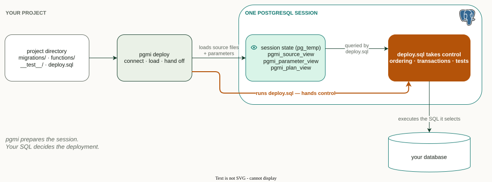

# pgmi Documentation

pgmi is a PostgreSQL-native deployment tool that loads your project files into session temp tables and lets your `deploy.sql` drive everything — transactions, execution order, and logic. These docs cover the session API, CLI, deployment patterns, testing, security, and operational guides.



## Articles

**Deployment**

- [Test PostgreSQL migrations before COMMIT](https://vvka-141.github.io/pgmi/articles/test-postgresql-migrations-before-commit/): where the test gate sits, after lint and rehearsal
- [Your ALTER TABLE Is Fast. The Queue Behind It Is Not.](https://vvka-141.github.io/pgmi/articles/lock-queue-fast-is-not-safe/): bounded lock waits and phased deploys; runnable in [`examples/lock-safe-deploy/`](https://github.com/vvka-141/pgmi/tree/main/examples/lock-safe-deploy)
- [Your Transaction Boundary Belongs in the Program, Not the Filename](https://vvka-141.github.io/pgmi/articles/transaction-boundary-in-the-program/): transactions decided in deploy.sql
- [Your Migration Numbers Are a Distributed Counter Without Coordination](https://vvka-141.github.io/pgmi/articles/migration-numbers-distributed-counter/): a pull-request check on `pgmi_plan_view` rejects duplicate numbers before merge
- [Your Deployment Is a PostgreSQL Program](https://vvka-141.github.io/pgmi/articles/deployment-is-a-postgresql-program/): the deployment as code you can read and test

**Testing and data**

- [Scenario-Tree Testing in PostgreSQL](https://vvka-141.github.io/pgmi/articles/test-every-branch-before-commit/): several outcomes from one setup, each branch isolated by savepoints
- [From Seed Scripts to Desired-State Reference Data](https://vvka-141.github.io/pgmi/articles/desired-state-reference-data-postgresql/): reference data validated, diffed and reconciled from a file; runnable in [`examples/seed-demo/`](https://github.com/vvka-141/pgmi/tree/main/examples/seed-demo)

**Application design**

- [The Request Becomes a Transaction](https://vvka-141.github.io/pgmi/articles/request-becomes-a-transaction/): API tests inside the deploy transaction
- [AI agents write PostgreSQL like Python](https://vvka-141.github.io/pgmi/articles/ai-agents-write-postgresql-like-python/): the handler discipline that keeps agent-written PL/pgSQL correct

## Recommended Reading Order

**New to pgmi?** Start here:
1. [Quickstart](QUICKSTART.md) — Deploy your first project
2. [Choose a template](templates.md) — Minimal, basic and advanced side by side
3. [Why pgmi](WHY-PGMI.md) — Understand the philosophy
4. [Core vs. template](core-vs-template.md) — What pgmi gives you, and what you own
5. [Highlights](HIGHLIGHTS.md) — What pgmi does that other tools can't
6. [Session API](session-api.md) — Learn the session API
7. [Trade-offs](TRADEOFFS.md) — Understand the honest costs

**Migrating from another tool?**
1. [Coming from other tools](COMING-FROM.md) — Flyway, Liquibase, psql migration guides
2. [Quickstart](QUICKSTART.md) — See pgmi in action

**Writing deploy.sql?**
1. [deploy.sql guide](DEPLOY-GUIDE.md) — Patterns cookbook (data ingestion, environment branching, multi-phase)
2. [Session API](session-api.md) — Views, columns, and functions reference

**Setting up production?**
1. [Connections](CONNECTIONS.md) — Connection architecture (cloud auth, SSL, poolers)
2. [Security](SECURITY.md) — Secrets and CI/CD patterns
3. [CI/CD](CICD.md) — Deploy from GitHub Actions and other pipelines
4. [Production](PRODUCTION.md) — Performance and rollback strategies
5. [CLI reference](CLI.md) — All flags and exit codes

**Adding tests?**
1. [Testing](TESTING.md) — `CALL pgmi_test()` and fixtures

**Using the basic template?**
1. [Basic template](basic/README.md) — Two layers, the run-once ledger and the test gate
2. [Testing](TESTING.md) — `CALL pgmi_test()` and fixtures

**Using the advanced template?**
1. [Advanced template overview](advanced/README.md) — What the application stack ships and what you can remove
2. [Script metadata](METADATA.md) — Script tracking with `<pgmi-meta>`
3. [MCP overview](advanced/MCP.md) — Expose your deployed application to AI assistants

---

## Quick Answers

| Question | Answer |
|----------|--------|
| Which view should I use? | `pgmi_plan_view` for deployment, `pgmi_source_view` for introspection — see [Session API](session-api.md#which-view-should-i-use) |
| How do I access CLI parameters? | `current_setting('pgmi.key', true)` — see [Session API](session-api.md#parameters) |
| How do I run tests? | `CALL pgmi_test()` in deploy.sql — see [Testing](TESTING.md) |
| What's the difference between templates? | Basic = two layers: run-once tables, and views and functions re-run on every deploy, behind a test gate. Advanced = a full, tested PostgreSQL application stack (one handler registry → REST+RPC+MCP+OpenAPI, RLS auth, transaction policy, audit trails) — more infrastructure, not a higher safety tier. Either is production-capable; see [Choose a template](templates.md) |
| How do I filter which files run? | Join `pgmi_plan_view` to `pgmi_source_view`, require `is_sql_file`, then add your path filter — see [Session API](session-api.md) |
| What exit codes does pgmi use? | 0=success, 13=SQL error, etc. — see [CLI reference](CLI.md#exit-codes) |

---

## All Documentation

### Getting Started
- **[Quickstart](QUICKSTART.md)** — Your first deployment (install, configure, deploy, verify)
- **[Why pgmi](WHY-PGMI.md)** — When pgmi's approach makes sense (and when it doesn't)
- **[Core vs. template](core-vs-template.md)** — The boundary between pgmi core and your scaffolded project
- **[Highlights](HIGHLIGHTS.md)** — Ten distinctive pgmi capabilities, grounded in code and guides
- **[Coming from other tools](COMING-FROM.md)** — Migration guides from Flyway, Liquibase, and raw psql
- **[Choose a template](templates.md)** — Minimal, basic and advanced compared: who each is for and what each ships
- **[Basic template](basic/README.md)** — Two layers, the run-once ledger and the test gate

### Reference
- **[CLI reference](CLI.md)** — Complete CLI reference (commands, flags, exit codes, error messages)
- **[Configuration](CONFIGURATION.md)** — pgmi.yaml schema and precedence rules
- **[Session API](session-api.md)** — Session views and functions (`pg_temp.pgmi_*`)

### Guides
- **[deploy.sql guide](DEPLOY-GUIDE.md)** — deploy.sql authoring patterns (data ingestion, environment branching, multi-phase)
- **[Connections](CONNECTIONS.md)** — Connection architecture (cloud auth, SSL, poolers, IaC)
- **[Trade-offs](TRADEOFFS.md)** — Honest limitations and who should use pgmi

### Features
- **[Testing](TESTING.md)** — Database testing with savepoint isolation and deploy gates
- **[Script metadata](METADATA.md)** — Script tracking with UUIDs, idempotency, sort keys
- **[Security](SECURITY.md)** — Secrets handling and CI/CD patterns

### Operations
- **[CI/CD](CICD.md)** — Deploy from GitHub Actions and other pipelines
- **[Go library](GO-LIBRARY.md)** — Run a deploy from your own Go program
- **[Production](PRODUCTION.md)** — Performance, rollback strategies, monitoring

### Advanced template (code you own)
These pages document application code scaffolded by `pgmi init --template advanced` — a complete PostgreSQL application stack, not a pgmi core feature. The generated SQL and gateways become code you own, modify, or delete. Start at the [capability tour](advanced/README.md).

- **[MCP overview](advanced/MCP.md)** — What the MCP support scaffolds, what you operate, and where to start
- **[Client guides](advanced/clients/README.md)** — Generate typed clients from your deployment's OpenAPI contract
- **[Transaction policy](advanced/TRANSACTION-POLICY.md)** — Per-route isolation floor, read-only declaration, DEFERRABLE derivation, fail-closed enforcement, replica-safe hint
- **[Run the MCP gateway](advanced/MCP-GATEWAY.md)** — Start the reference gateway, connect an AI client, and operate it in production
- **[MCP handlers](advanced/MCP-HANDLERS.md)** — Authoring MCP tool/resource/prompt handlers
- **[MCP protocol](advanced/MCP-PROTOCOL.md)** — JSON-RPC wire protocol and session lifecycle
- **[MCP SQL API](advanced/MCP-SQL-API.md)** — SQL functions powering the MCP gateway
- **[Login transport contract](advanced/LOGIN-TRANSPORT.md)** — What the web server in front of the database must do: OIDC sign-in, the session cookie and headers, logout
- **[Upgrading](advanced/UPGRADING.md)** — Take template fixes into a project you have changed, and move from v0.13 to v0.14
- **[Trade-offs](TRADEOFFS.md#the-advanced-template-is-a-real-program)** — The advanced template is a real program you maintain
- **[Semantic MCP curation](advanced/semantic-mcp-tool-curation.md)** — Optional extension to the MCP gateway: surface the relevant tool subset by embedding similarity (for tool-overload scale)

### AI Integration
```bash
pgmi ai                    # Overview for AI assistants
pgmi ai contract           # Session API contract (views/functions)
```

A scaffolded project carries its own skills in `.agents/skills/`.
See [CLI.md#pgmi-ai](CLI.md#pgmi-ai) for details.
