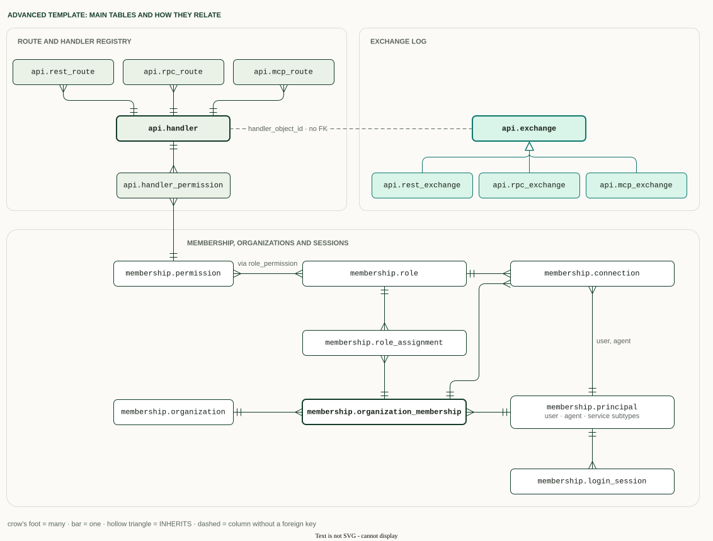
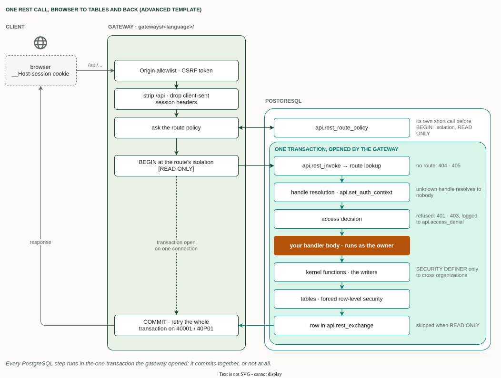
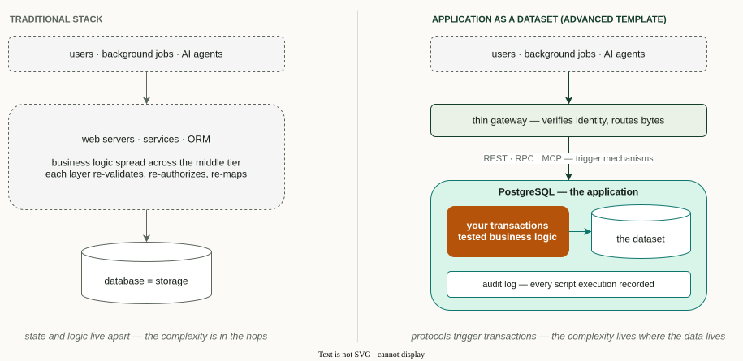
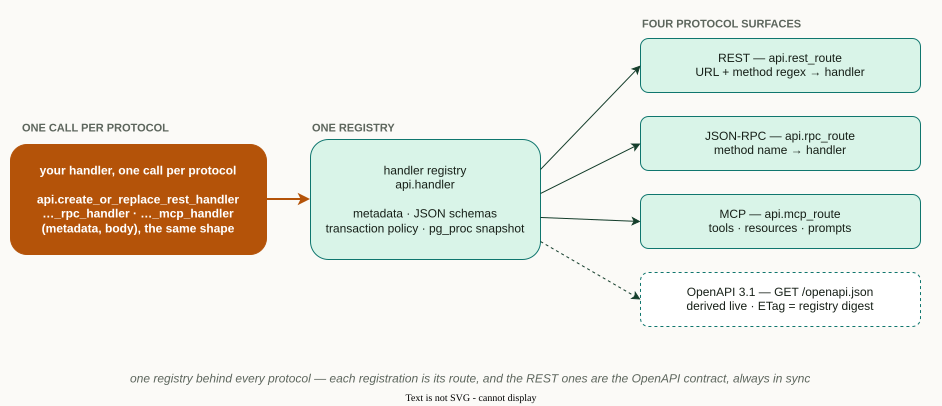
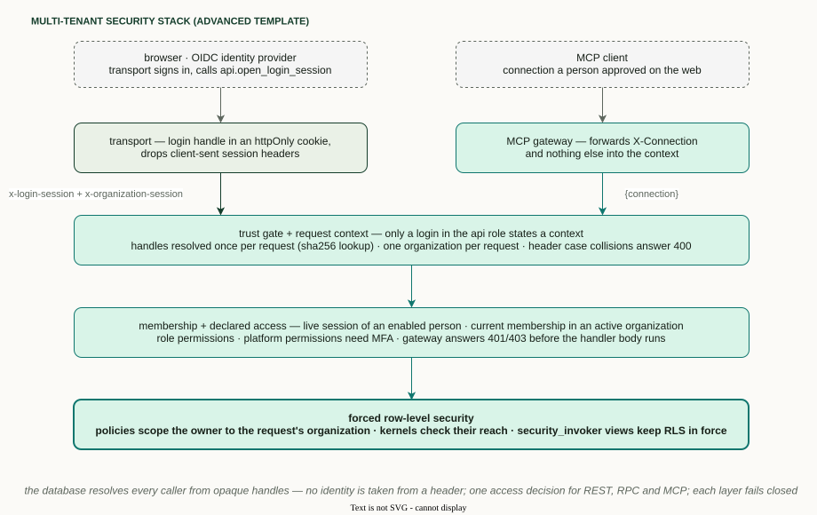
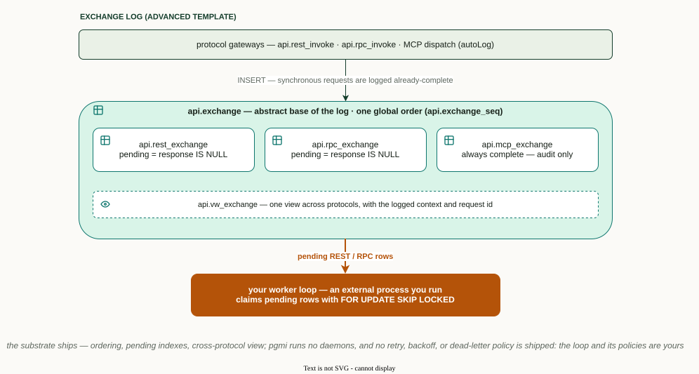

# The advanced template

The advanced template is a heavily opinionated backend in PostgreSQL. It gives
a rapid start with security, performance and REST, RPC and MCP routing inside
the database. Gateways keep only the cross-cutting concerns: TLS, sign-in,
token checks, CSRF and timeouts. It is for teams that want the database to
own the application, not only its data.

It suits applications whose rules must hold for every caller: multi-tenant
SaaS backends, internal business systems, and applications that AI agents
operate. Callers get coarse operations, never tables. A handler checks
access and calls one kernel function. The kernel enforces the business rules
and writes, and the request commits or is refused as one transaction. For an
agent, that means it calls an operation, and its kernel commits it or refuses
it ([agents as callers](MCP.md#agents-as-callers)).

This is one way to build on pgmi, not the way. pgmi itself takes no position
on architecture: the basic template keeps the application outside the
database and calls functions over SQL.

Every database project first meets the same problem: remember which scripts
already ran, and do not run them again. That infrastructure takes work to
build, so the template ships it, calls pgmi's built-in test gate before its
`COMMIT`, and adds request logging on top.
It is scaffolding: after `pgmi init` the code belongs to you, to keep, change
or replace. pgmi itself only runs your `deploy.sql`; the minimal template
shows it bare.

The advanced template is pre-1.0: a later release may again need a new
database, and template fixes arrive by manual merge
([Upgrading](UPGRADING.md)).

## What you get out of the box

- **Deploy history.** `internal.deployment`, `internal.deployment_script`,
  `internal.deployment_script_content` and
  `internal.deployment_script_execution_log` record every file each deploy
  ran; read them through `internal.vw_deployment` and
  `internal.vw_deployed_script`.
- **Run-once drift refusal.** A run-once file that already ran and was then
  edited, moved, removed or given another sort key refuses the deploy.
- **Environment label.** `internal.environment` keeps `dev`, `test` or `prod`
  from the first deploy; a deploy with a different `env` is refused.
- **Exchange log.** Each REST, RPC and MCP request is logged in
  [`api.exchange`](#the-exchange-log) and its per-protocol children.
- **Jobs.** A job driver with a run log (`internal.job_run_log`) and one
  shipped job, `CALL api.job_purge_exchanges()`, for cron or `pg_cron`.
- **Deploy guards.** An advisory lock against concurrent deploys,
  `lock_timeout`, the run-once and re-run file contract, a check for grants
  that disappeared, and no routine executable by `PUBLIC`.
- **Test gate.** `CALL pgmi_test()` runs the tests inside the deploy
  transaction, before `COMMIT`; a failing test commits nothing.
- **Membership.** People and agents, organizations, roles, invitations, and
  login and organization sessions, with [row-level security](#multi-tenant-identity-and-rls).
- **Five reference gateways** in Python, TypeScript, Go, C# and Rust
  ([details](#five-reference-gateways-at-parity)).


## How the database is designed

The database has three layers. Tables, keys and row-level security sit in the
physical layer, in run-once files. Views, kernel functions and refusal
functions form the semantic layer; kernels are the only writers. The API layer
holds handler registrations, which shape input and output and call one kernel.
A gateway calls only the API layer. The sort keys put your own entities under
`005/100/`.


Three groups of tables carry the framework. The route and handler registry
(`api.handler` with its REST, RPC and MCP routes) is what every protocol and
the OpenAPI document are read from. The exchange log (`api.exchange` and its
per-protocol children) records requests. Membership holds principals,
organizations, roles, connections and login sessions.



## Why in the database

Routing, the handler registry and the gateway contract live in PostgreSQL.
The gateway keeps TLS, sign-in, token checks, CSRF and timeouts. That split
buys four things:

- **Fewer round trips.** Route lookup is an indexed query, one policy lookup
  (an extra round trip) runs before `BEGIN`, and the handler reads and writes next to its data: no
  round trips between application code and the database inside the
  transaction ([Limits](TRANSACTION-POLICY.md#limits)).
- **Security.** Every application table is forced to row-level security or
  exempted with a reason, and constraints keep membership consistent: an
  exclusion constraint allows one owner per organization at a time.
- **Integrity.** A request runs in one transaction, and its exchange-log row
  commits with it, or neither does.
- **Cohesion.** REST routes, JSON-RPC methods and MCP tools register in one
  registry, each protocol with its own call, and can share one kernel; a REST
  registration also yields its OpenAPI entry
  ([one declaration, many derivations](#one-handler-registry-four-protocol-surfaces-in-sql)).

It has costs: your team writes PL/pgSQL, and the application is tied to
PostgreSQL. [Trade-offs](../TRADEOFFS.md) lists them.

## How a request flows

The gateway asks the route's policy, opens one transaction at that isolation
level, and calls the database. Access is checked before the handler runs. A
route that declares repeatable read or serializable answers from one snapshot;
the default is read committed. The gateway commits, or retries the whole
transaction on a serialization failure or deadlock.



## How to start

You need PostgreSQL 18 or newer, a role with `CREATEROLE` and `CREATEDB`, and
the `uuid-ossp`, `pgcrypto`, `pg_trgm`, `hstore` and `btree_gist` extensions;
no superuser ([requirements](../templates.md#advanced-template-requirements)). Scaffold the project, then run the
first deploy as `pgmi init` prints it:

```bash
pgmi init myapp --template advanced
pgmi deploy myapp -d mydb --param env=dev
```

For a shared database use `env=test` or `env=prod`, with the passwords in
`PGMI_PARAM_*` environment variables or a `--params-file`. Then read the
scaffolded `README.md` and `ARCHITECTURE.md`; the template documents itself.
Its Quick Start step "Run a gateway" creates the gateway's database login and
answers a first request.

## Before you choose it

- **What serves HTTP.** A gateway. The reference gateways serve REST under
  `/api` and MCP on `/mcp`, with OIDC sign-in; the Go gateway also serves
  JSON-RPC on `/rpc`. A gateway holds the database credentials and invokes
  SQL handlers; the database checks access.
- **Per request.** The gateway resolves the route's isolation level and
  read-only mode, then opens one transaction. The database checks access
  before the handler runs. A route that declares repeatable read or
  serializable answers from one snapshot; the default is read committed. The
  gateway retries serialization failures and deadlocks.
- **Pooling.** PgBouncer transaction pooling works at runtime, because the
  request context is set per transaction. Only the deploy needs a session of
  its own.
- **Requirements.** PostgreSQL 18 or newer, no superuser; see the
  [Production Guide](../PRODUCTION.md#managed-cloud-postgresql).
- **Updates.** A newer template does not update your project: you port the
  changes you want by hand. A v0.13 database cannot be upgraded in place; see
  [Upgrading](UPGRADING.md).
- **Removal.** You can delete the gateways, `api/dev/`, change tracking, the
  entity registry and per-organization numbering; CI deploys the template
  after removing each one separately. Membership is a ready-made starting
  point for the most common multi-tenant SaaS access model: organizations,
  roles and enterprise-style permissions on each endpoint. It is working code
  you own: keep it, reshape it, or replace it with a different access model in
  PostgreSQL, or open endpoints that need no sign-in. `lib/` calls its identity
  readers, so deleting the `membership/` folder alone fails the deploy.
  Removing or replacing it is a routine refactor, and the test suite tells you
  when you're done. MCP support runs through the shared API files; without
  registered MCP handlers it stays dormant.

## What else to know on day one

- **Identity and access.** Each handler declares its access: `public`,
  `authenticated`, `organization` (any member of the session's organization)
  or a list of `permissions`. The database answers 401 or 403 before the body
  runs, the same way for every protocol. Permissions and the organization
  roles that grant them are defined in `data/authorization.json` and synced on
  every deploy.
- **Organizations.** Signing in creates no organization; a platform operator
  creates one and invites its members. Self-serve creation exists only in
  `api/dev/`, which deploys with `env=dev` alone.
- **Machine access.** Machine callers use an approved connection or the
  [jobs login](https://github.com/vvka-141/pgmi/blob/main/shared/templates/advanced/README.md#the-jobs-login-optional).
  API keys are not supported. An approved MCP client has its own identity and
  an `agent.*` role, and its permissions cannot exceed those of the person who
  approved it ([details](#multi-tenant-identity-and-rls)).
- **Retry-safe writes.** The template provides no idempotency keys. A
  retry-safe write states its precondition in the write itself, as the
  scaffolded `pgmi-handlers` skill shows (`references/concurrency.md`).
- **Logging.** Requests are logged by default in the
  [exchange log](#the-exchange-log). A `readOnly` route is not logged,
  because its transaction cannot write the log. MCP exchanges are always
  logged, so an MCP handler cannot be `readOnly`.
- **Tests gate the deploy.** API tests run inside the deploy transaction; a
  failing test aborts the deploy before anything commits.

## The architecture: application as a dataset

The template embodies one architectural stance — your application *is* the
PostgreSQL database. All state lives there as a modeled dataset; external
actors modify it through well-defined, tested transactions; REST, RPC, and
MCP endpoints are trigger mechanisms for those transactions, not homes for
business logic.



The scaffolded [`ARCHITECTURE.md`](https://github.com/vvka-141/pgmi/blob/main/shared/templates/advanced/ARCHITECTURE.md)
develops this in depth — the transaction-first workflow and when *not* to
choose this template.

## The capabilities in detail

### One handler registry, four protocol surfaces in SQL

Each protocol has its own registration call, `api.create_or_replace_rest_handler`,
`api.create_or_replace_rpc_handler` or `api.create_or_replace_mcp_handler`, and
all three write to one registry, `api.handler`. From it come REST routing by
declared path, JSON-RPC by method name, MCP tools, resources and prompts for AI
agents, and a live OpenAPI 3.1 document of the REST routes. An operation offered
over two protocols is two registrations over one kernel. The
shipped gateways expose REST, MCP and the OpenAPI document over HTTP, and the
Go gateway JSON-RPC at `POST /rpc`.

Choose REST for resources a client reads and changes, JSON-RPC for a named
action that changes several rows in one step (the template ships one,
`organization.transfer_ownership`), and MCP for what AI agents call.

The rule behind it is "one declaration, many derivations": nothing the gateway
enforces is left out of the published contract, and nothing published goes
unenforced. Routing is liberal about how a client spells a path and exact about
which resource it names. The
[design record](../design/transactional-web-boundary.md) explains why, and is
the page to read before changing how routes are matched.



- The contract is **self-describing and cacheable**: `GET /openapi.json`
  serves a strong ETag derived from the registry, every response stamps
  `x-pgmi-catalog-version`, and `GET /docs` renders an interactive explorer.
  A client that preloads routes learns its contract went stale from a call it
  was already making — the caching makes client-side routing *safe*, not
  merely fast.
  [Generate typed clients](clients/README.md) from it in any language.
- **Discovery is auth-aware**: `api.mcp_list_tools` and the other MCP
  listings hide the entries a caller may not call from that session.
  `/openapi.json` is filtered by caller class only: anyone can fetch it, an
  anonymous caller sees the public routes, and any authenticated caller sees
  every authenticated route, including ones its permissions refuse (an
  `/admin/*` path answers such a caller 403). The filter is for readability, not protection:
  method sets are public, and the gateway's access decision is what guards
  an operation. Its ETag carries the caller class, so an authenticated copy
  never revalidates for an anonymous caller. `/docs`
  renders whatever `/openapi.json` returns, through a version-pinned script
  with a subresource-integrity hash.
- **Method sets are public**: `OPTIONS` on a matched path answers `204` with
  `Allow` before any identity check, because a CORS preflight carries no
  credentials. A wrong method gets `405` with the same `Allow`, whoever asks.
  An anonymous call to a protected method gets `401`.
- Handlers follow a defensive four-phase discipline (materialize → validate →
  probe → execute) with RFC 9457 problem responses — see the scaffolded
  `api/examples.sql` for working handlers of every protocol.
- The MCP surface is a complete server implementation in SQL with scaffolded
  HTTP transports — [its own five-page section](MCP.md) covers it.

### Declarative per-route transaction policy

A route declares what it needs — `minTransactionIsolation` (an isolation
floor) and `readOnly` — and the client gateway resolves the policy *before*
opening the transaction: `max(floor, requested)` isolation, `READ ONLY` when
declared, `DEFERRABLE` for serializable read-only routes (which can never hit
a serialization failure and need no retries). The SQL gateways enforce the
same policy fail-closed for callers that skip the lookup, serialization
failures propagate with their SQLSTATE so clients know to retry, and OpenAPI
advertises each route's policy — including an honest `x-pgmi-replica-safe`
hint. Full reference: [Transaction policy](TRANSACTION-POLICY.md); gateway-specific details: [MCP gateway — transaction policy](MCP-GATEWAY.md#transaction-policy).

### Multi-tenant identity and RLS

- **Membership model**: principals (people and services) with their
  identity-provider logins, organizations with a lifecycle, time-ranged
  memberships and role assignments, exactly one owner, invitations accepted
  only by a verified matching email, and an audit log. Roles grant permissions
  from a closed vocabulary in `data/authorization.json`. Signing in creates no
  organization.
- **Session authentication**: after an OIDC sign-in the transport calls
  `api.open_login_session`, the only path that provisions a person (linked to
  an existing one only when both have verified the email). Requests carry two
  opaque handles, `x-login-session` and `x-organization-session`; the database
  resolves them into one person and at most one organization per request, read
  through `api.current_principal_id()` and `api.current_organization_id()`.
  The transport's duties are the
  [login transport contract](LOGIN-TRANSPORT.md).
- **Agent principals**: an MCP caller is the agent of a connection a person
  approved on the web. The agent has its own principal and an `agent.*` role
  (`agent.reader`, `agent.contributor`, `agent.delegate`). It acts for the
  person (the effective principal, which row-level security sees) with the
  role's permissions intersected with the person's, in the organization
  chosen at approval. Every request carries an actor kind (`human`,
  `agent`, `service`, `system`), and the audit log, change tracking and the
  exchange log record both principals. People pause, resume and revoke their
  agents; managers do the same for their organization, and the owner can
  switch every agent off. Nothing on MCP provisions anyone.
- **OAuth for MCP clients, with pairing**: with `MCP_RESOURCE` set, a gateway
  is an OAuth 2.1 resource server. It publishes protected-resource metadata,
  verifies access tokens from your identity provider with a strict audience
  check, and passes the database only the issuer, subject and client id. A
  new client's first call answers a six-character pairing code; the person
  approves it on the web, choosing organization and agent role. Headless
  scripts can use an approved `X-Connection` handle instead. Rate limits per
  address and per client guard `/mcp`.
- **Row-level security** isolates organizations at the table level: every
  application table is forced to row-level security with a policy, or exempt
  with a reason, and the deploy's tests fail on any other table.



### Five reference gateways at parity

`gateways/` holds a reference gateway in Python, TypeScript, Go, C# and Rust.
Each is written the way its language is usually written, and each serves the
same surface but one: the Go gateway also serves JSON-RPC on `POST /rpc`; the
other four do not, and adding it to one is a route that calls
`api.rpc_route_policy` and `api.rpc_invoke` (`gateways/PROTOCOL.md`). The shared
surface is REST under `/api`, MCP on `/mcp` (both protocol eras), OIDC
sign-in, the OAuth resource server and the rate limits. They follow one
written protocol (`gateways/PROTOCOL.md`), read the same environment
variables, and pass one language-neutral end-to-end suite in CI. They are
examples to read and port, written for people and coding agents alike; every
project decision is marked `ADAPT`.

Each gateway has two extension seams, so a project adds behaviour without
touching request handling:

- **The database channel**: every database call behind one interface.
  Serialization retry, connection retry and tracing are decorators composed
  once at startup; a cache or a test double is one more.
- **Interceptors**: change a request before its transaction opens (add an
  embedding for a field marked `"x-embed": true`), or a response after its
  commit (sign a storage URL). Each selects itself from what the database
  publishes about the handler, costs nothing on routes it does not select,
  and fails with 502 `pgmi.interceptor_failed` or degrades, as it declares.

The database still decides who may call what: the gateway knows no
protocol version, no route and no permission.

**What a coding agent did with it.** In the v0.14 evaluation, Claude Code and
Codex each started from an empty directory, built a small app on this
template (tables, REST routes and an MCP tool with declared access, tests) and
served it through the Python gateway. A second agent with no earlier
conversation then extended it on the same database without losing data. That
is one run per agent, through one of the five gateways
([method and limits](../design/ai-guidance-in-the-scaffold.md#how-success-is-measured)).

### Audit trails on both planes

- **Deployment plane**: every script execution is recorded in
  `internal.deployment_script_execution_log` — UUID identity, checksum,
  timestamp, executing role — and read through `internal.vw_deployment` and
  `internal.vw_deployed_script`. The same log lets run-once files run once
  and refuses a deploy when one that already ran was edited, moved or removed.
- **Request plane**: protocol exchanges (REST/RPC/MCP) inherit from one
  abstract `api.exchange` — the subject of the next section. Error paths
  record the SQLSTATE with truncated detail — never raw error text that could
  leak attacker-supplied input.

### The exchange log

Every logged exchange lands in one inheritance hierarchy with a single
global order and one cross-protocol view, `api.vw_exchange`:



- **It is a log, not a queue.** The synchronous gateways write a row after the
  request completed. pgmi runs no daemons; the pending-row indexes only serve
  work you choose to enqueue and claim yourself (`FOR UPDATE SKIP LOCKED`),
  with your own retry policy.
- **No credentials are kept.** Authorization, cookies, API keys, token and
  CSRF headers, session and MCP connection handles (`X-Connection`) and the
  Referer are dropped from the logged copy, on success and on error;
  `internal.application_unloggable_headers()` adds your own.
- **Find a request by its id.** The transport's `x-request-id` stays in the
  logged headers: `SELECT * FROM api.vw_exchange WHERE request_id = '...'`.
- **List what one principal did.** `GET /admin/exchanges` pages the log
  newest first, for platform operators; `?protocol=rest|rpc|mcp` narrows it to
  one protocol and `?actualPrincipalId=<uuid>` to the exchanges that principal
  made, such as one agent's calls (an index on each exchange table serves it).
- **Replay as the caller.** Each row keeps the context
  `internal.request_log_context()` returned (the principal, organization and
  second factor in this template). `api.replay_exchange(id)` applies it,
  re-runs a REST or RPC request through the same access decision and rolls
  back everything it did. Admin only; `POST /admin/exchanges/{id}/replay`
  answers the replayed response to a platform operator.
- **Retention.** `exchange_retention_days` (default 30) sets what the
  `purge_exchanges` background job keeps (`CALL api.job_purge_exchanges()`,
  scheduled by cron or `pg_cron`) and the default of the admin purge endpoint.
- **The api role can write exchanges but not read them** — request/response
  payloads (including sanitized error detail) are ops data, readable by the
  admin role only, so a compromised api session cannot mine other requests'
  failures.

### A deploy contract that refuses drift

Structure (tables, indexes, types, policies) lives in run-once files of plain
DDL; code (functions, views, registrations) in re-run files. `deploy.sql`
refuses a file of the wrong kind, an edited run-once file, a deploy whose
`env` does not match the database's recorded label, a grant or policy that
disappeared without a declared removal, and an invalid index left by a
concurrent build. Privileges start closed: no routine is executable by
`PUBLIC`. Lookup tables can be synced from `data/catalogs/*.json`. The
template requires PostgreSQL 18.

### Tested end to end

The stack ships with its own test suite — protocol dispatch, auth
enforcement, error mapping, RLS isolation, transaction
policy, membership flows — all running inside the deploy transaction with
savepoint rollback, so a failing test aborts the deployment before anything
commits. It is a working demonstration of
[pgmi's test-gated deployment model](../TESTING.md) at application scale.

## Reference

| You want to | Read |
|---|---|
| Understand the architecture stance | scaffolded `ARCHITECTURE.md` |
| Write the web server that signs people in | [Login transport contract](LOGIN-TRANSPORT.md) |
| Expose your application to AI assistants | [MCP gateway overview](MCP.md) |
| Run and operate a scaffolded HTTP gateway | [Run the MCP gateway](MCP-GATEWAY.md) |
| Write a gateway in another language, or extend one | scaffolded `gateways/README.md` and `gateways/PROTOCOL.md` |
| Write tools, resources, and prompts | [Author MCP handlers](MCP-HANDLERS.md) |
| Generate a typed client | [Client guides](clients/README.md) |
| Version the API surface | [Design: API versioning](../design/api-versioning.md) |
| Change routing, OpenAPI, or handler metadata | [Design: the transactional web boundary](../design/transactional-web-boundary.md) |
| Upgrade a database from an earlier template | [Upgrading](UPGRADING.md) |
