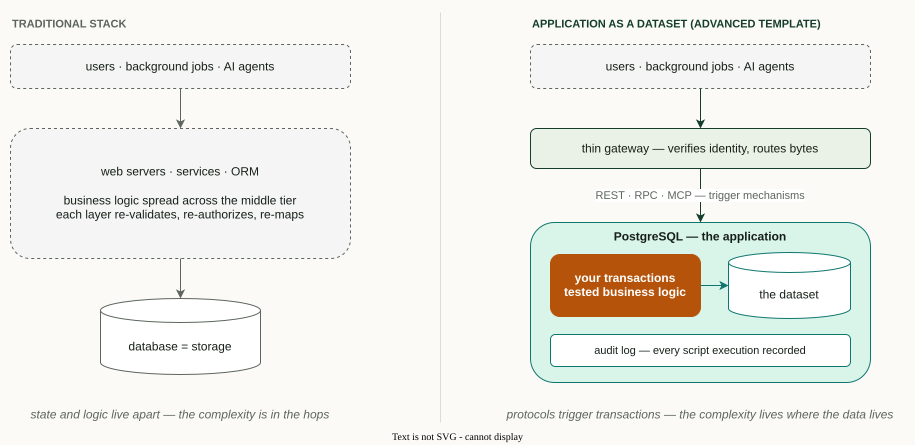
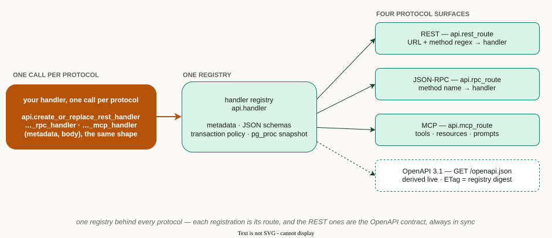
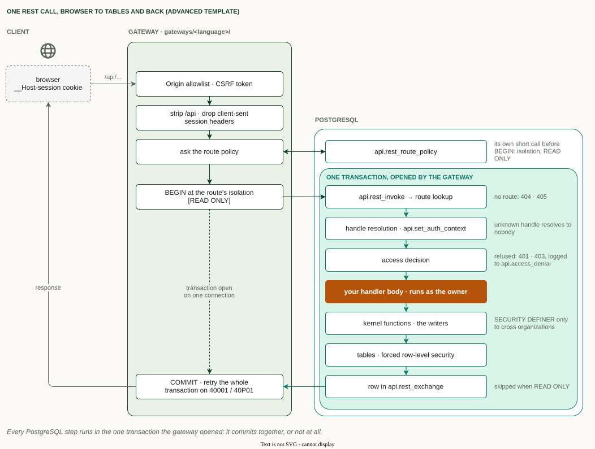
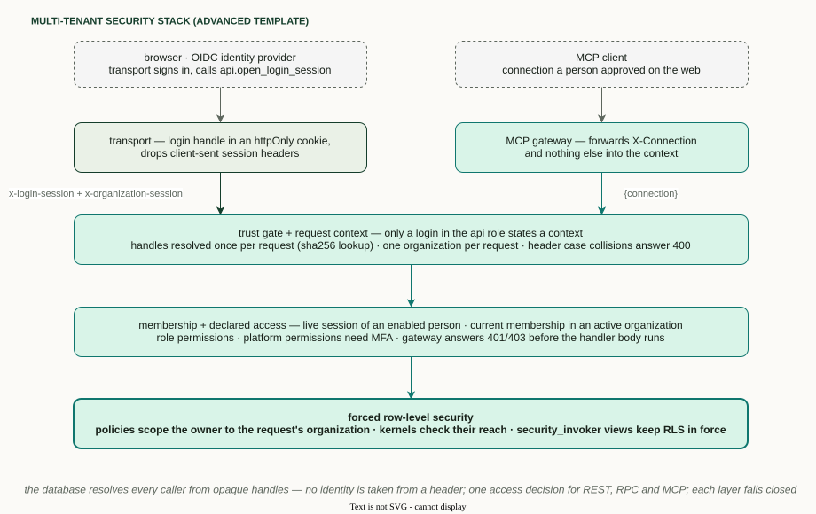
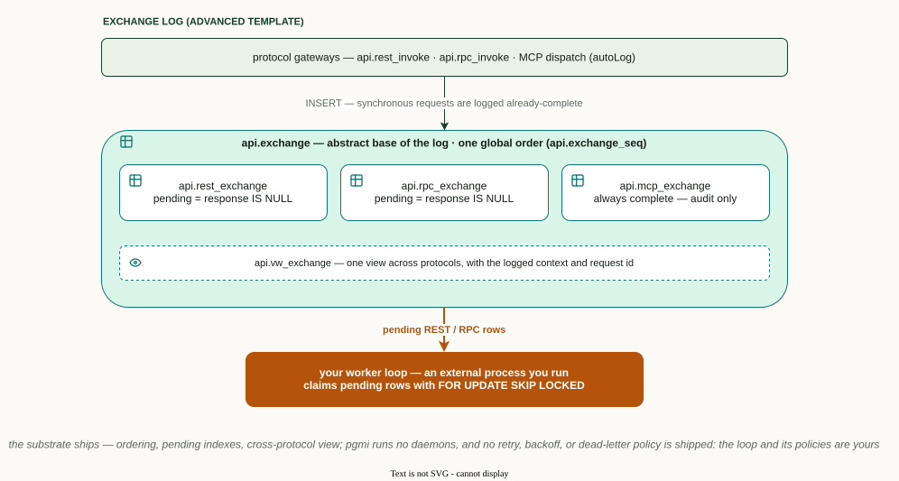

# The advanced template

pgmi ships two templates, and the boundary between them is a product boundary,
not a safety tier:

- **basic** is the starting point — a flat, explicit project you can read in
  one sitting: migrations, tests, a single-transaction `deploy.sql`.
- **advanced** is a **reference application to read and take from** — a
  complete PostgreSQL application stack scaffolded into your project. It is
  more infrastructure, not "more production-ready"; either template is
  production-capable.

Everything documented in this section is **application code you own** after
`pgmi init --template advanced`. None of it is part of pgmi core: pgmi's job
ends at preparing the session and executing your `deploy.sql`; from there the
scaffolded SQL is yours to keep, modify, or delete.

## The architecture: application as a dataset

The template embodies one architectural stance — your application *is* the
PostgreSQL database. All state lives there as a modeled dataset; external
actors modify it through well-defined, tested transactions; REST, RPC, and
MCP endpoints are trigger mechanisms for those transactions, not homes for
business logic.



The scaffolded [`ARCHITECTURE.md`](https://github.com/vvka-141/pgmi/blob/main/internal/scaffold/templates/advanced/ARCHITECTURE.md)
develops this in depth — the three-layer design (physical → virtual → API),
the transaction-first workflow, and when *not* to choose this template.

## What you get out of the box

### One handler registry, four protocol surfaces

Register a handler once — `api.create_or_replace_rest_handler` (or its
`rpc`/`mcp` sibling) — and the registry derives every surface from that single
registration: REST routing by declared path, JSON-RPC by method name, MCP tools,
resources, and prompts for AI agents, and a live OpenAPI 3.1 document.

The rule behind it is "one declaration, many derivations": nothing the gateway
enforces is left out of the published contract, and nothing published goes
unenforced. Routing is liberal about how a client spells a path and exact about
which resource it names. The
[design record](../design/transactional-web-boundary.md) explains why, and is
the page to read before changing how routes are matched.



- The contract is **self-describing and cacheable**: `GET /openapi.json`
  serves a strong ETag derived from the registry, every response stamps
  `x-pgmi-catalog-version`, and `GET /docs` renders an interactive explorer.
  A client that preloads routes learns its contract went stale from a call it
  was already making — the caching makes client-side routing *safe*, not
  merely fast.
  [Generate typed clients](clients/_index.md) from it in any language.
- **Discovery is auth-aware on every surface**: `api.mcp_list_tools` and the
  other MCP listings hide the entries a caller may not call from that
  session, and so does `/openapi.json`. The document is public but filtered:
  anyone can fetch it, and only an authenticated caller sees the
  authenticated routes. The filter is for readability, not protection:
  method sets are public, and the gateway's access decision is what guards
  an operation. Its ETag carries the caller class, so an authenticated copy
  never revalidates for an anonymous caller. `/docs`
  renders whatever `/openapi.json` returns, through a version-pinned script
  with a subresource-integrity hash.
- **Method sets are public**: `OPTIONS` on a matched path answers `204` with
  `Allow` before any identity check, because a CORS preflight carries no
  credentials. A wrong method gets `405` with the same `Allow`, whoever asks.
  An anonymous call to a protected method gets `401`.
- Handlers follow a defensive four-phase discipline (materialize → validate →
  probe → execute) with RFC 9457 problem responses — see the scaffolded
  `api/examples.sql` for working handlers of every protocol.
- The MCP surface is a complete server implementation in SQL with scaffolded
  HTTP transports — [its own five-page section](MCP.md) covers it.

A request travels the whole stack inside one transaction — resolved before
`BEGIN`, rejected fail-closed before dispatch, or answered by your SQL from a
single snapshot:



### Declarative per-route transaction policy

A route declares what it needs — `minTransactionIsolation` (an isolation
floor) and `readOnly` — and the client gateway resolves the policy *before*
opening the transaction: `max(floor, requested)` isolation, `READ ONLY` when
declared, `DEFERRABLE` for serializable read-only routes (which can never hit
a serialization failure and need no retries). The SQL gateways enforce the
same policy fail-closed for callers that skip the lookup, serialization
failures propagate with their SQLSTATE so clients know to retry, and OpenAPI
advertises each route's policy — including an honest `x-pgmi-replica-safe`
hint. Full reference: [Transaction policy](TRANSACTION-POLICY.md); gateway-specific details: [MCP gateway — transaction policy](MCP-GATEWAY.md#transaction-policy).

### Multi-tenant identity and RLS

- **Membership model**: principals (people and services) with their
  identity-provider logins, organizations with a lifecycle, time-ranged
  memberships and role assignments, exactly one owner, invitations accepted
  only by a verified matching email, and an audit log. Roles grant permissions
  from a closed vocabulary in `data/authorization.json`. Signing in creates no
  organization.
- **Session authentication**: after an OIDC sign-in the transport calls
  `api.open_login_session`, the only path that provisions a person (linked to
  an existing one only when both have verified the email). Requests carry two
  opaque handles, `x-login-session` and `x-organization-session`; the database
  resolves them into one person and at most one organization per request, read
  through `api.current_principal_id()` and `api.current_organization_id()`.
  The transport's duties are the
  [login transport contract](LOGIN-TRANSPORT.md).
- **Agent principals**: an MCP caller is the agent of a connection a person
  approved on the web. The agent has its own principal and an `agent.*` role
  (`agent.reader`, `agent.contributor`, `agent.delegate`). It acts for the
  person (the effective principal, which row-level security sees) with the
  role's permissions intersected with the person's, in the organization
  chosen at approval. Every request carries an actor kind (`human`,
  `agent`, `service`, `system`), and the audit log, change tracking and the
  exchange log record both principals. People pause, resume and revoke their
  agents; managers do the same for their organization, and the owner can
  switch every agent off. Nothing on MCP provisions anyone.
- **OAuth for MCP clients, with pairing**: with `MCP_RESOURCE` set, a gateway
  is an OAuth 2.1 resource server. It publishes protected-resource metadata,
  verifies access tokens from your identity provider with a strict audience
  check, and passes the database only the issuer, subject and client id. A
  new client's first call answers a six-character pairing code; the person
  approves it on the web, choosing organization and agent role. Headless
  scripts can use an approved `X-Connection` handle instead. Rate limits per
  address and per client guard `/mcp`.
- **Row-level security** isolates organizations at the table level: every
  application table is forced to row-level security with a policy, or exempt
  with a reason, and the deploy's tests fail on any other table.



### Five reference gateways at parity

`gateways/` holds a reference gateway in Python, TypeScript, Go, C# and Rust.
Each is written the way its language is usually written, and each serves the
same surface: REST under `/api`, MCP on `/mcp` (both protocol eras), OIDC
sign-in, the OAuth resource server and the rate limits. They follow one
written protocol (`gateways/PROTOCOL.md`), read the same environment
variables, and pass one language-neutral end-to-end suite in CI. They are
examples to read and port, written for people and coding agents alike; every
project decision is marked `ADAPT`.

Each gateway has two extension seams, so a project adds behaviour without
touching request handling:

- **The database channel**: every database call behind one interface.
  Serialization retry, connection retry and tracing are decorators composed
  once at startup; a cache or a test double is one more.
- **Interceptors**: change a request before its transaction opens (add an
  embedding for a field marked `"x-embed": true`), or a response after its
  commit (sign a storage URL). Each selects itself from what the database
  publishes about the handler, costs nothing on routes it does not select,
  and fails with 502 `pgmi.interceptor_failed` or degrades, as it declares.

The database still decides who may call what: the gateway knows no
protocol version, no route and no permission.

### Audit trails on both planes

- **Deployment plane**: every script execution is recorded in
  `internal.deployment_script_execution_log` — UUID identity, checksum,
  timestamp, executing role — and read through `internal.vw_deployment` and
  `internal.vw_deployed_script`. The same log lets run-once files run once
  and refuses a deploy when one that already ran was edited, moved or removed.
- **Request plane**: protocol exchanges (REST/RPC/MCP) inherit from one
  abstract `api.exchange` — the subject of the next section. Error paths
  record the SQLSTATE with truncated detail — never raw error text that could
  leak attacker-supplied input.

### The exchange log

Every logged exchange lands in one inheritance hierarchy with a single
global order and one cross-protocol view, `api.vw_exchange`:



- **It is a log, not a queue.** The synchronous gateways write a row after the
  request completed. pgmi runs no daemons; the pending-row indexes only serve
  work you choose to enqueue and claim yourself (`FOR UPDATE SKIP LOCKED`),
  with your own retry policy.
- **No credentials are kept.** Authorization, cookies, API keys, token and
  CSRF headers, session and MCP connection handles (`X-Connection`) and the
  Referer are dropped from the logged copy, on success and on error;
  `internal.application_unloggable_headers()` adds your own.
- **Find a request by its id.** The transport's `x-request-id` stays in the
  logged headers: `SELECT * FROM api.vw_exchange WHERE request_id = '...'`.
- **Replay as the caller.** Each row keeps the context
  `internal.request_log_context()` returned (the principal, organization and
  second factor in this template). `api.replay_exchange(id)` applies it,
  re-runs a REST or RPC request through the same access decision and rolls
  back everything it did. Admin only; `POST /admin/exchanges/{id}/replay`
  answers the replayed response to a platform operator.
- **Retention.** `exchange_retention_days` (default 30) sets what the
  `purge_exchanges` background job keeps (`CALL api.job_purge_exchanges()`,
  scheduled by cron or `pg_cron`) and the default of the admin purge endpoint.
- **The api role can write exchanges but not read them** — request/response
  payloads (including sanitized error detail) are ops data, readable by the
  admin role only, so a compromised api session cannot mine other requests'
  failures.

### A deploy contract that refuses drift

Structure (tables, indexes, types, policies) lives in run-once files of plain
DDL; code (functions, views, registrations) in re-run files. `deploy.sql`
refuses a file of the wrong kind, an edited run-once file, a deploy whose
`env` does not match the database's recorded label, a grant or policy that
disappeared without a declared removal, and an invalid index left by a
concurrent build. Privileges start closed: no routine is executable by
`PUBLIC`. Lookup tables can be synced from `data/catalogs/*.json`. The
template requires PostgreSQL 18.

### Tested end to end

The stack ships with its own test suite — protocol dispatch, auth
enforcement, error mapping, RLS isolation, transaction
policy, membership flows — all running inside the deploy transaction with
savepoint rollback, so a failing test aborts the deployment before anything
commits. It is a working demonstration of
[pgmi's test-gated deployment model](../TESTING.md) at application scale.

## Where to start

Scaffold it and read the generated `README.md` and `ARCHITECTURE.md` — the
template documents itself:

```bash
pgmi init --template advanced myproject
```

Then pick the page that matches your intent:

| You want to | Read |
|---|---|
| Understand the architecture stance | scaffolded `ARCHITECTURE.md` |
| Write the web server that signs people in | [Login transport contract](LOGIN-TRANSPORT.md) |
| Expose your application to AI assistants | [MCP gateway overview](MCP.md) |
| Run and operate a scaffolded HTTP gateway | [Run the MCP gateway](MCP-GATEWAY.md) |
| Write a gateway in another language, or extend one | scaffolded `gateways/README.md` and `gateways/PROTOCOL.md` |
| Write tools, resources, and prompts | [Author MCP handlers](MCP-HANDLERS.md) |
| Generate a typed client | [Client guides](clients/_index.md) |
| Version the API surface | [Design: API versioning](../design/api-versioning.md) |
| Change routing, OpenAPI, or handler metadata | [Design: the transactional web boundary](../design/transactional-web-boundary.md) |
