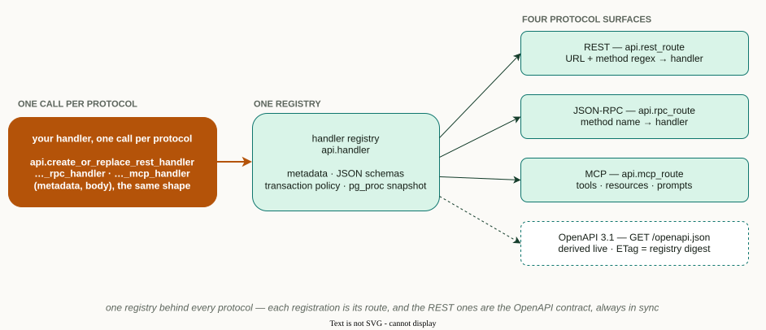

# Client Generation

> These guides cover consuming the REST/RPC endpoints the advanced template
> serves — they are not clients for the pgmi deployment CLI.

The advanced template serves an OpenAPI 3.1 specification at `GET /openapi.json` and an interactive explorer at `GET /docs`; behind a reference gateway they are `/api/openapi.json` and `/api/docs` (the gateways listen on port 8080 by default). Use these to generate typed clients in any language.

The document lists only the routes the caller may call. Fetched anonymously, it omits every route not declared `'access', 'public'`. So every recipe here downloads the spec once, with session handles, and generates from the file:

```bash
curl -fsS \
  -H "Cookie: __Host-session=$LOGIN_SESSION" \
  -H "x-organization-session: $ORGANIZATION_SESSION" \
  -o openapi.json http://localhost:8080/api/openapi.json
```

Use a person whose roles cover the routes the client needs. The gateway takes the login session from its `__Host-session` cookie and drops a client-sent `x-login-session` header. With an `env=dev` deploy and a gateway started with `DEV_LOGIN=1`, sign in with

```bash
curl -si -X POST http://localhost:8080/auth/dev-login -H "Content-Type: application/json" \
  -d '{"subject": "alice", "email": "alice@example.com", "displayName": "Alice"}'
```

It answers 204 with two cookies: `__Host-session` (the login session) and `__Host-csrf`. Send both as the `Cookie` header, and the `__Host-csrf` value as `X-CSRF-Token` on every request that is not GET, HEAD or OPTIONS. `POST /api/organization-sessions` with `{"organizationId": "..."}` returns an organization session for `x-organization-session`. Elsewhere sign-in is your transport's OIDC flow; see the [login transport contract](../LOGIN-TRANSPORT.md). Several generators (oapi-codegen, NSwag) take a URL but no header option, which is another reason to generate from the file.

The spec is not hand-written — it is derived live from the same handler
registry that routes REST, RPC, and MCP, so it can never drift from the
deployed surface:



pgmi does not ship client libraries. Your deployment owns the spec; your pipeline owns the client.

The scaffolded project does ship reference *gateways*, the server side in front of
PostgreSQL, under `gateways/`: Python, TypeScript, Go, C# and Rust, and `gateways/PROTOCOL.md`,
the wire rules every client keeps. Read them before writing your own gateway.

MCP clients are not generated from this document. An AI client connects to
`/mcp` with OAuth (its first call answers a pairing code the person approves
with `POST /api/connections/approve`, naming `organizationId` and an agent
`roleId`) or with a handle approved through `POST /api/connections`; see
[Run the MCP gateway](../MCP-GATEWAY.md).

## Quick Start

1. Deploy your project with pgmi
2. Open `http://localhost:8080/api/docs` for the interactive API explorer
3. Download `openapi.json` with session handles (above)
4. Pick a language below and generate a typed client from the file

## Language Recipes

| Language | Tool | Recipe |
|----------|------|--------|
| TypeScript | openapi-typescript | [TypeScript](typescript.md) |
| Go | oapi-codegen | [Go](go.md) |
| Python | openapi-python-client | [Python](python.md) |
| C# | NSwag | [C#](csharp.md) |
| Rust | openapi-generator (`-g rust`) | [Generic](generic.md) |
| Any | openapi-generator | [Generic](generic.md) |

Rust has no page of its own: openapi-generator's `rust` generator is the
usual choice there, and the generic recipe covers it.

## HTTP Collections

For ad-hoc exploration without codegen, see [HTTP collections](http-collection.md) to generate importable request files for Bruno, VS Code REST Client, or IntelliJ.

## Philosophy

These recipes teach the approach, not pinned versions. The spec is the source of truth; the generated client is a downstream artifact in your CI pipeline. When your handlers change, re-run the generator.
